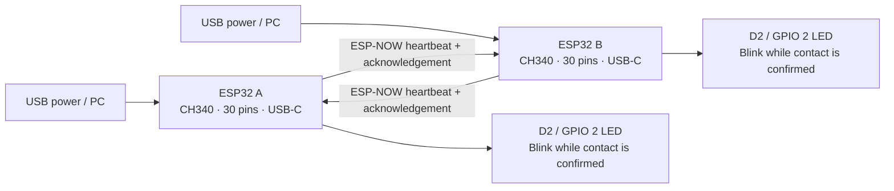
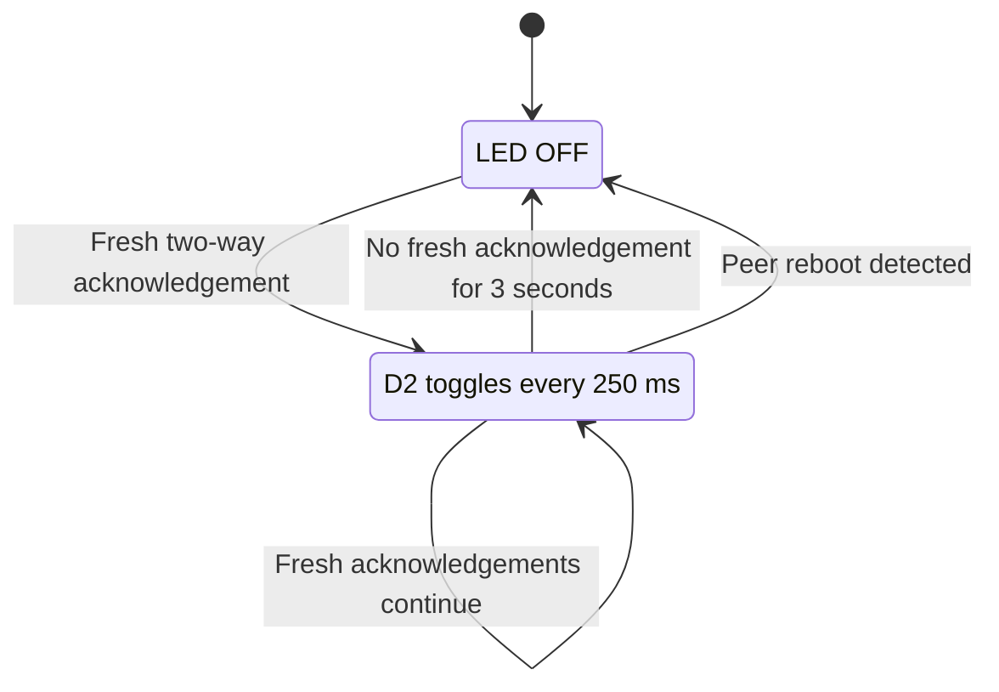

# ESP32NOW — ESP-NOW Range Indicator

Two ESP32 boards discover each other over ESP-NOW and blink their **D2 / GPIO 2
LEDs while messages are passing in both directions**. When contact stops, the
LEDs turn off after approximately **3 seconds**. They resume blinking
automatically when communication returns.

Upload the **same firmware to both boards**. There are no sender/receiver roles,
Wi-Fi credentials, or MAC addresses to enter.

> This project indicates working radio communication. It does not measure
> physical distance or guarantee a particular range. Walls, interference,
> antenna orientation, and the power supply affect communication.

## System diagram



The boards communicate directly over their Wi-Fi radios. No router, internet
connection, or signal wire between boards is needed. Each board has its own
power connection. CH340 handles USB-to-serial communication for uploading and
Serial Monitor; the ESP32 handles ESP-NOW.

## Hardware and configuration

This configuration targets a **classic ESP32 development board with CH340,
30 pins, USB Type-C, and 4 MB flash**, using PlatformIO's `esp32dev` profile.
It is not a configuration for ESP32-S3, C3, or other chip variants.

| Item | Configuration |
| --- | --- |
| PlatformIO environment / board | `esp32dev` |
| Framework | Arduino |
| LED output | D2 / GPIO 2 |
| LED polarity | Active HIGH by default |
| Wi-Fi interface | Station, without joining a router |
| Wi-Fi channel | 1 on both boards |
| Heartbeat interval | 400–600 ms, with randomized timing |
| Contact timeout | 3,000 ms |
| LED toggle interval | 250 ms: two complete blinks per second |
| Upload / Serial Monitor baud | 115200 |
| USB serial port | Automatically detected |

**Required hardware:** two supported ESP32 boards and reliable USB power
connections. Use a USB **data** cable for uploading. Both boards must remain
powered during the communication test.

The firmware assumes your board has a controllable LED on GPIO 2. Board clones
can differ: check the board's LED connection if Serial Monitor reports contact
but the LED does not blink. A permanently lit power LED cannot be controlled
by this sketch. The two LEDs blink independently, so their timing may differ.

## How communication is confirmed

Each board sends a small broadcast heartbeat containing its boot identifier,
sequence number, and acknowledgement of the latest heartbeat received from the
other board. Both boards use the same channel and application group value.

```mermaid
sequenceDiagram
    participant A as ESP32 A
    participant B as ESP32 B
    A->>B: Heartbeat A1
    Note over B: Receive A1; prepare acknowledgement
    B->>A: Heartbeat B1 + acknowledgement of A1
    Note over A: Fresh reply confirms two-way contact; start blinking
    A->>B: Heartbeat A2 + acknowledgement of B1
    Note over B: Fresh reply confirms two-way contact; start blinking
    A->>B: Continue periodic heartbeats + acknowledgements
    B->>A: Continue periodic heartbeats + acknowledgements
    Note over A,B: If fresh acknowledgements stop for 3 seconds, LEDs turn off
```

A successful `esp_now_send()` call alone does **not** start blinking. The
other board must acknowledge a heartbeat that this board actually submitted
recently. This checks the path in both directions.

The source MAC identifies the discovered board. Boot identifiers separate
messages from different runs; sequence numbers identify fresh messages.
The firmware ignores invalid, self-originated, duplicate, and reordered
heartbeats. Stale or unknown acknowledgements cannot refresh contact.
Wi-Fi receive callbacks copy messages into a queue; the main loop handles
contact tracking and LED output without blocking the radio task.



## Open and build in VS Code

1. Install VS Code and the **PlatformIO IDE** extension.
2. Clone this repository, or download and extract it.
3. Open the **project root folder**, containing `platformio.ini`, in VS Code.
4. Select the **esp32dev** environment in PlatformIO.
5. Click **Build**. PlatformIO installs the required platform and framework.

The existing local project folder may be named `ESP32SNOW`; the GitHub
repository is named `ESP32NOW`. Either folder name works. Keep the whole
project, including `include/range_link.h`, rather than copying only `main.cpp`.

### PlatformIO configuration

The functional settings in [platformio.ini](platformio.ini) are:

```ini
[platformio]
default_envs = esp32dev

[env:esp32dev]
platform = espressif32
board = esp32dev
framework = arduino
monitor_speed = 115200
upload_speed = 115200
monitor_dtr = 0
monitor_rts = 0
```

Serial Monitor starts with DTR and RTS deasserted to avoid holding the board
in reset. No fixed serial port is stored in the project.

## Flash the boards one at a time

1. Connect **board A** to the PC with a USB data cable.
2. Click PlatformIO **Upload** for environment **esp32dev**.
3. Disconnect board A and connect **board B**.
4. Upload the **same project** to board B.
5. Power both boards and place them near each other.
6. Open **Serial Monitor at 115200 baud** on whichever board is connected
   to the PC.

If both are connected to the PC at once, select the intended upload port in
PlatformIO. Each board needs only its own power supply for normal operation.

### Terminal commands

Run these from the project root using a terminal where `pio` is available
(for example, PlatformIO's terminal in VS Code):

```sh
pio run --environment esp32dev
pio device list
pio run --environment esp32dev --target upload --upload-port /dev/ttyUSB0
pio device monitor --port /dev/ttyUSB0 --baud 115200
```

Replace `/dev/ttyUSB0` with the detected port: it may be another `/dev/ttyUSB*`
on Linux, `COM*` on Windows, or `/dev/cu.*` on macOS. Close Serial Monitor
before uploading if it keeps the port busy.

## Expected behavior and physical test

| Test | Expected result |
| --- | --- |
| Only one board powered | Its D2 LED stays off |
| Both boards powered nearby | Both D2 LEDs blink after heartbeat exchange |
| One board switched off | Remaining board's LED turns off in about 3 seconds |
| Boards separated until communication fails | LEDs stop blinking after timeout |
| Other board powered again or brought back | Blinking resumes automatically |
| A board rebooted | Fresh contact is established again |

Typical Serial Monitor output is:

```text
Waiting for the other board...
IN RANGE: D2 LED blinking
IN RANGE | TX attempts=10 RX=9 ACK=8
CONTACT LOST: LED off
WAITING / OUT OF RANGE | TX attempts=18 RX=9 ACK=8
```

The numbers above are illustrative. A status line is printed every two seconds.

| Counter / message | Meaning |
| --- | --- |
| `TX attempts` | Heartbeat send attempts; this does not prove reception |
| `RX` | Accepted heartbeats from the discovered peer |
| `ACK` | Fresh acknowledgements of recently submitted heartbeats |
| `IN RANGE` | Recent two-way contact; LED blinking enabled |
| `WAITING / OUT OF RANGE` | Fresh two-way contact is absent; LED off |

## Change settings

| Setting | File | Default | Purpose |
| --- | --- | --- | --- |
| `LED_PIN` | [src/main.cpp](src/main.cpp) | `2` | Controllable LED GPIO |
| `LED_ACTIVE_LOW` | [src/main.cpp](src/main.cpp) | `false` | Set `true` if LOW turns the LED on |
| `WIFI_CHANNEL` | [src/main.cpp](src/main.cpp) | `1` | Keep the same on both boards |
| `kGroup` | [include/range_link.h](include/range_link.h) | `0x32B11A01` | Keep the same for this pair |
| `kTimeoutMs` | [include/range_link.h](include/range_link.h) | `3000` | Contact-loss timeout |
| `kBlinkMs` | [include/range_link.h](include/range_link.h) | `250` | Time between LED toggles |

Rebuild and upload after changing settings. Use a different `kGroup` for another
pair operating nearby. This is a simple **unencrypted** broadcast demo, and the
group value is a packet filter, not authentication. It assumes two participating
boards per group. Do not connect either board to a router from this sketch;
a router connection can change the radio channel.

## Tests and verification

The same `RangeLink` class is used in the firmware and host tests. The host
suite simulates two boards and exercises the contact and LED logic, including:

- A single powered board and two-board discovery.
- Two-way contact, blink timing, the timeout boundary, and reconnection.
- One-direction failure and moderate packet loss.
- Peer/local reboots and equal boot identifiers on distinct boards.
- Invalid, self-originated, duplicate, and reordered packets.
- Stale acknowledgements and acknowledgements of unsent packets.
- Clock/sequence rollover and an unrelated third board.

On Linux with Python 3 and g++ installed, run:

```sh
python3 test/run_host_tests.py
pio run --environment esp32dev
```

The tests compile with strict warnings, AddressSanitizer, and
UndefinedBehaviorSanitizer. **All 16 software scenarios and the `esp32dev`
firmware build passed during preparation of this project.** Physical radio
reception, power stability, and onboard LED operation still require the
board-to-board test after flashing.

## Troubleshooting

| Symptom | What to check |
| --- | --- |
| `RX=0`, LED off | Power both boards, upload matching firmware, keep channel/group settings identical, and place boards nearby |
| `RX` increases but `ACK` stays at zero | Verify both boards remain running and messages can pass both ways; compare their serial logs |
| `IN RANGE` shown but LED does not blink | Check `LED_PIN`, `LED_ACTIVE_LOW`, and whether the board has a controllable GPIO 2 LED |
| Repeated `Brownout detector was triggered` | Supply voltage is dropping; try a reliable cable and USB source, remove external loads, and check the board power circuit |
| Upload port missing | Use a data-capable cable and check CH340 USB-serial support on the PC |
| Permission denied on Linux | Grant access to the detected serial device; see below |
| Upload cannot connect | Close Serial Monitor; hold BOOT during connection, then release it when writing starts |

For temporary Linux serial-port access, use your actual detected port:

```sh
sudo setfacl -m u:$(id -un):rw /dev/ttyUSB0
```

This permission may reset when the board is unplugged. The firmware keeps
brownout protection enabled; repeated resets must be resolved before radio
communication can be tested.

## Project layout

```text
ESP32NOW/
├── platformio.ini                 # Board, framework, upload and monitor settings
├── src/main.cpp                   # ESP-NOW callbacks, startup, queue and GPIO output
├── include/range_link.h           # Heartbeat, contact tracking and LED timing
├── test/host/test_range_link.cpp   # 16 deterministic software scenarios
├── test/run_host_tests.py          # Host compiler/test runner
├── .gitignore                     # Excludes build output and local editor data
└── README.md                      # Setup, diagrams and troubleshooting
```

## References

- [PlatformIO: Espressif ESP32 Dev Module](https://docs.platformio.org/en/stable/boards/espressif32/esp32dev.html)
- [Espressif: ESP-NOW API and acknowledgement guidance](https://docs.espressif.com/projects/esp-idf/en/release-v5.5/esp32/api-reference/network/esp_now.html)
- [Espressif: brownout and other fatal errors](https://docs.espressif.com/projects/esp-idf/en/latest/esp32/api-guides/fatal-errors.html)
